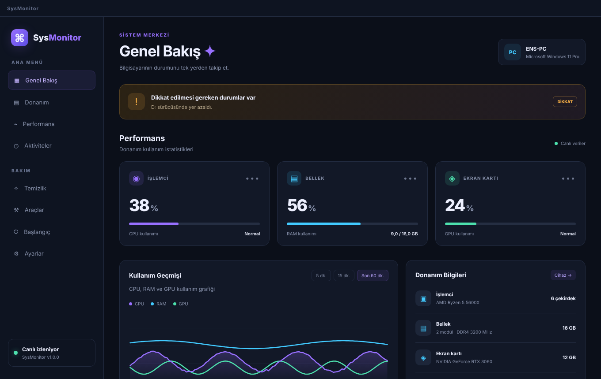
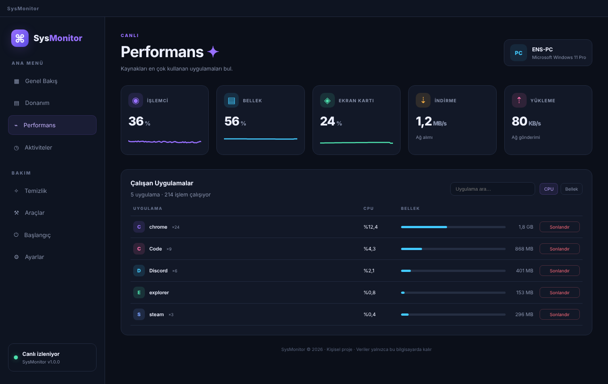
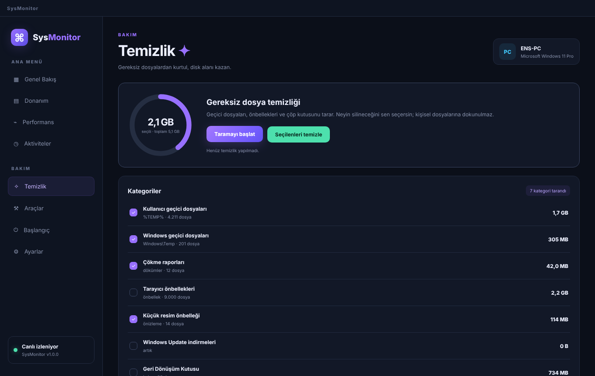
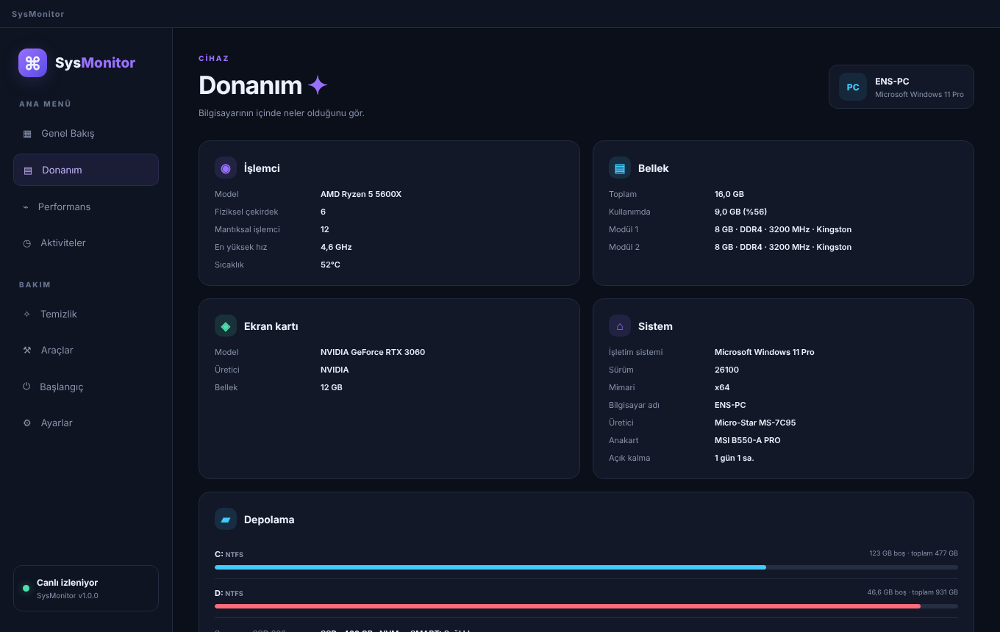
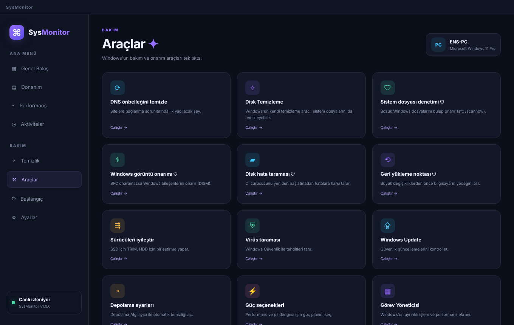

<p align="center"></p>

<h1 align="center">SysMonitor</h1>
<p align="center">Bilgisayarının durumunu tek yerden takip et, bakımını tek tıkla yap.</p>

<p align="center"><sub>Fikir ve tasarım: <b>Enes</b> (<a href="https://github.com/Enskygr234">@Enskygr234</a>)</sub></p>
<p align="center"><a href="../../releases/latest"><b>⬇ Windows için indir (Setup.exe)</b></a></p>

<p align="center"></p>

| | |
|---|---|
|  |  |
| Çalışan uygulamalar ve ağ hızı | Gereksiz dosya temizliği |
|  |  |
| Donanım bilgileri | Windows bakım araçları |

<sub>Ekran görüntülerindeki donanım değerleri örnektir; uygulama kendi bilgisayarının gerçek verilerini gösterir.</sub>

---

## Neler yapar?

| Bölüm | Ne var? |
|---|---|
| **Genel Bakış** | Canlı CPU, RAM ve GPU kartları, son 60 dakikanın kullanım grafiği, sistem sağlığı uyarıları |
| **Donanım** | İşlemci, bellek modülleri, ekran kartı, diskler (SMART durumu dahil), anakart, ağ ve pil bilgileri |
| **Performans** | Kaynakları en çok kullanan uygulamalar, arama, CPU/bellek sıralaması, tek tıkla sonlandırma, ağ hızı |
| **Temizlik** | Geçici dosyalar, tarayıcı önbellekleri, çökme raporları, küçük resim önbelleği, Windows Update artıkları ve Geri Dönüşüm Kutusu |
| **Araçlar** | DNS temizleme, SFC, DISM, disk hata taraması, geri yükleme noktası, sürücü iyileştirme ve Windows'un diğer bakım ekranları |
| **Başlangıç** | Windows açılırken çalışan uygulamaların listesi |
| **Aktiviteler** | Uyarıların, temizliklerin ve önemli olayların kaydı |
| **Ayarlar** | Windows ile başlatma, tepsiye küçültme, uyarı eşikleri, yenileme aralığı |

Arka planda simge tepsisinde çalışır; CPU veya RAM uzun süre yüksek kalırsa ya da disk dolmak üzereyse Windows bildirimi gönderir. Hiçbir veri bilgisayarından dışarı gönderilmez.

## Kurulum

1. [Releases](../../releases/latest) sayfasından `SysMonitor-Setup-x.y.z.exe` dosyasını indir.
2. Çalıştır. SmartScreen uyarısı çıkarsa **Ek bilgi → Yine de çalıştır**.
3. Kurulum klasörünü seç, bitir.

## Geliştirme

```bash
npm install
npm start        # uygulamayı aç
npm run dist     # dist/ klasörüne Setup.exe üret
```

`main` dalına yapılan her gönderimde GitHub Actions Windows üzerinde kurulum paketini derler, uygulamayı gerçek donanım verileriyle dener ve yeni `Setup.exe`'yi Releases'e yükler.

Electron · systeminformation · saf HTML/CSS/JS

## Yapımcılar

- **Fikir ve tasarım:** Enes ([@Enskygr234](https://github.com/Enskygr234)) — SysMonitor arayüz tasarımı
- **Kodlama:** Claude ile birlikte
